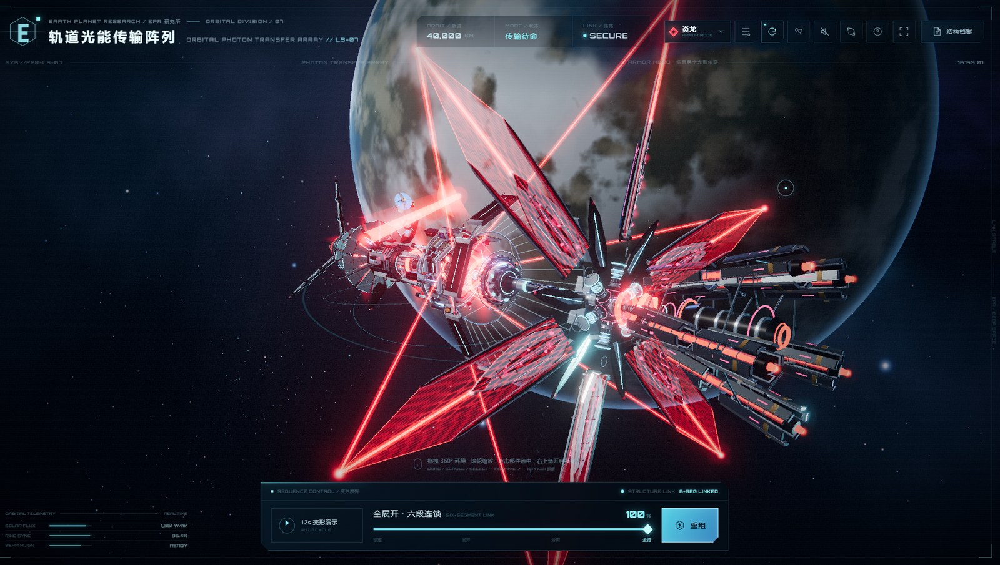
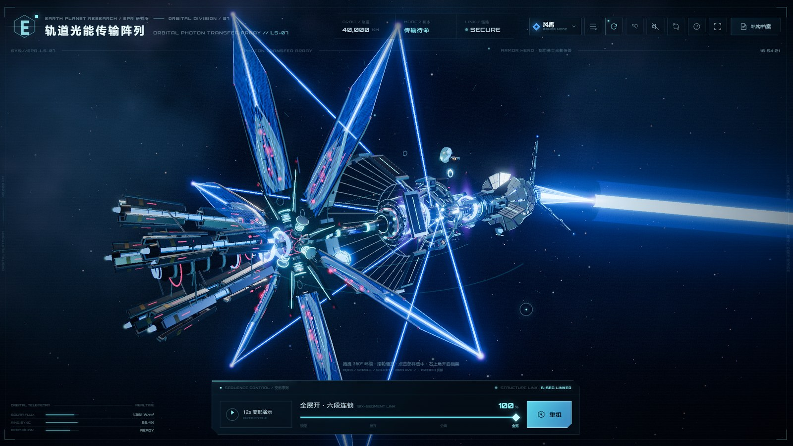
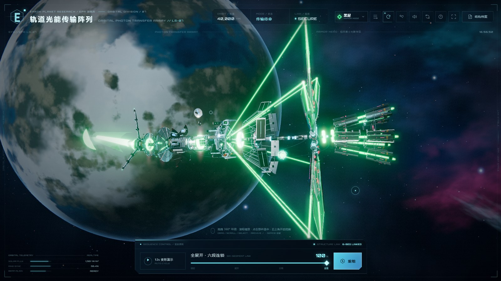
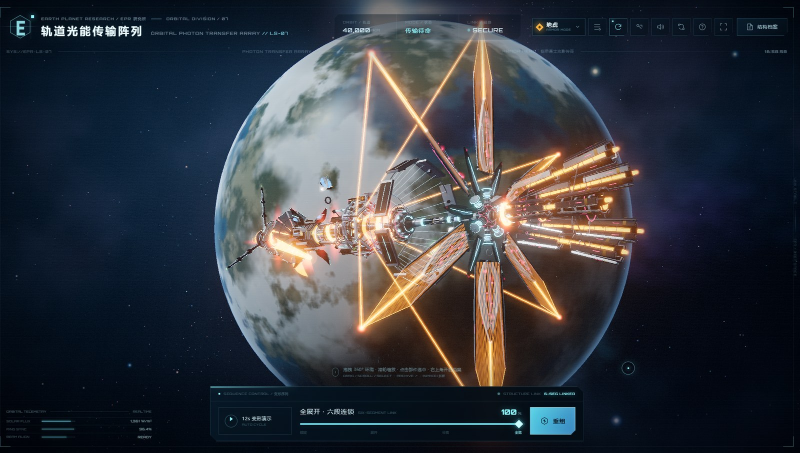
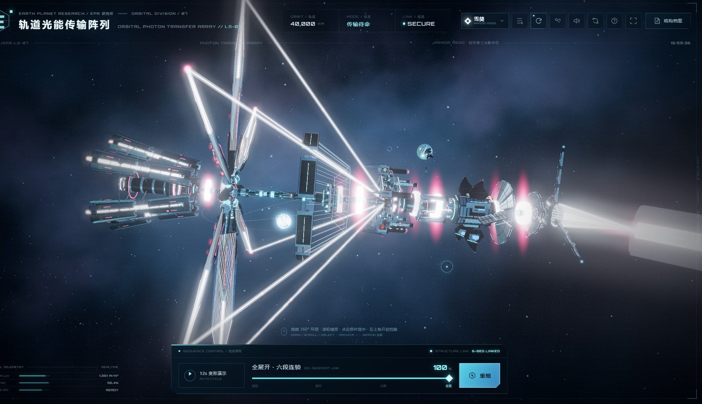

# 旧版开发记录

> 这些是开发过程中的旧版截图，期间临时借用了《铠甲勇士》相关设定作为视觉参考。
>
> 它们**不是当前五相版的原创设定**，也不代表项目最终方向。
>
> 这些图片不包含在 MIT 代码授权中；如相关权利人提出异议，会立即删除。

## 截图

## 说明

- 仅作开发过程记录和前后对比
- 图中 HUD、名称和标志均为旧版
- 当前五相版请以 `preview-five-phase.png` 为准
- 正式公开或商用前，建议替换或删除本目录
