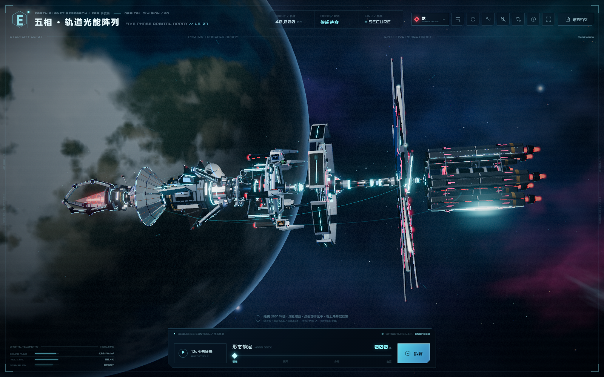

# EPR / 五相阵列 · 交互式拆解可视化

用 Three.js 程序化构建的轨道光能阵列，包含开放宇宙博物馆总览与独立卫星详情页。



## 在线入口

- 卫星详情：`index.html`
- 博物馆总览：`museum/index.html`
- LS-07 独立页：`satellites/ls07/index.html?from=museum`

## 结构

```text
index.html                       单文件卫星详情
museum/                          博物馆总览
satellites/ls07/                 LS-07 独立详情页
src/                             源码
build.mjs / package.json         构建
preview-five-phase*.png          预览
```

## 本地运行

```bash
npm install
npm run build
python -m http.server 8080
```

打开 `http://localhost:8080/`。

博物馆：

```text
http://localhost:8080/museum/
```

## GitHub Pages

仓库公开后：

```text
Settings → Pages → Deploy from a branch → main / (root)
```

站点入口：

```text
https://<username>.github.io/<repo>/
```

博物馆：

```text
https://<username>.github.io/<repo>/museum/
```

## 五相

- 龙：红
- 鹰：蓝
- 犀：绿
- 虎：橙
- 鹤：银

默认进入龙。`?phase=ying` 可直接打开鹰。

五张光徽已替换为新的五相光徽；旧版保留在 `media/emblems-legacy/`，不随 MIT 代码授权。

## 五相光徽

五张光徽仍在重绘中，生成提示词见 [EMBLEM-PROMPTS.md](EMBLEM-PROMPTS.md)。

## 旧版开发记录

开发过程中曾临时借用《铠甲勇士》设定作为视觉参考。相关旧版截图见 [LEGACY.md](LEGACY.md)，仅作历史记录，不随 MIT 授权。

## License

- **源代码：MIT**，见 [LICENSE](LICENSE)。
- **视觉资产、徽记、截图：保留所有权利**，不包含在 MIT 授权中，见 [LICENSE-ASSETS.md](LICENSE-ASSETS.md)。
- 第三方依赖许可见 [LICENSES.md](LICENSES.md)。
- 旧版开发截图见 [LEGACY.md](LEGACY.md)，仅作历史记录；如权利人异议会删除。

如果你要商用视觉资产，需要单独获得授权。

## 说明

本页是科幻概念可视化，不代表现实航天器数据。
