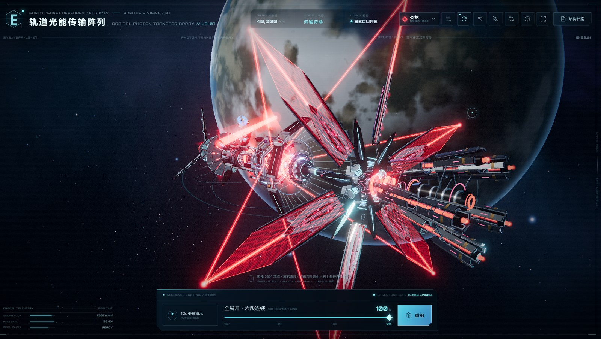
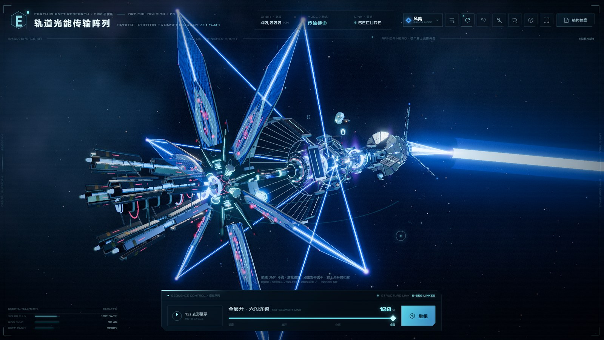
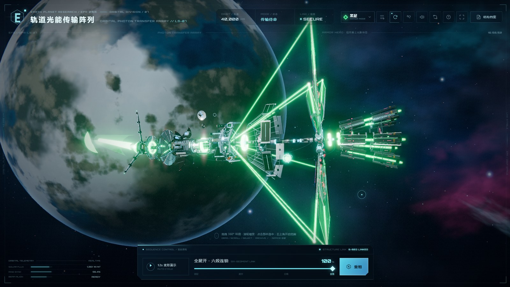
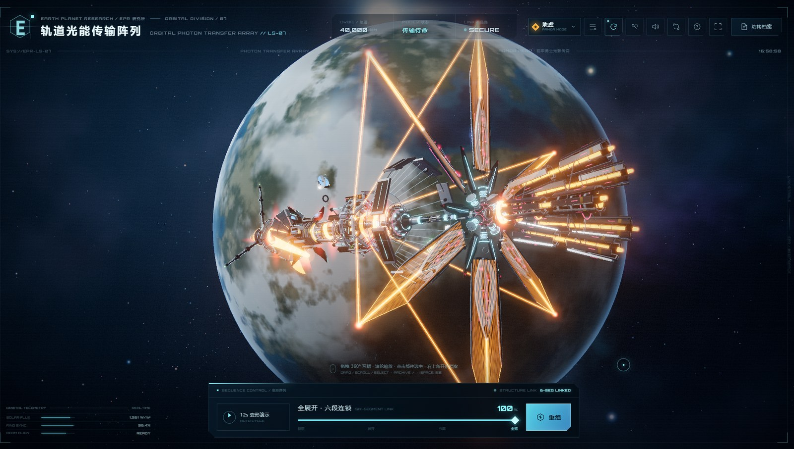
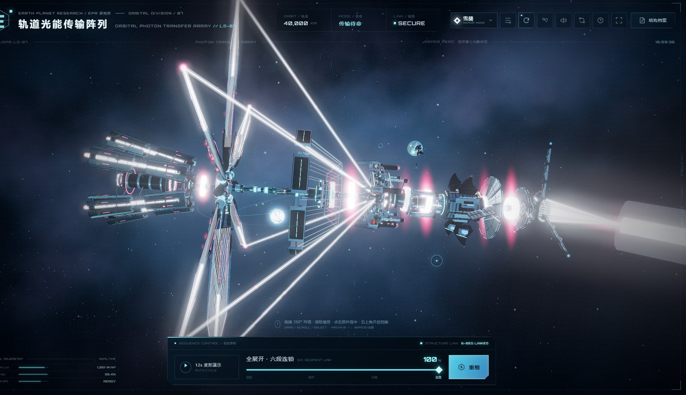

# EPR / 五相阵列 · 交互式拆解可视化

用 Three.js 程序化构建的轨道光能阵列，包含开放宇宙博物馆总览与独立卫星详情页。


## 在线入口

- 卫星详情：`index.html`
- 博物馆总览：`museum/index.html`
- LS-07 独立页：`satellites/ls07/index.html?from=museum`

## 结构

```text
index.html                       单文件卫星详情
museum/                          博物馆总览
satellites/ls07/                 LS-07 独立详情页
src/                             源码
build.mjs / package.json         构建
preview-five-phase*.png          预览
```

## 本地运行

```bash
npm install
npm run build
python -m http.server 8080
```

打开 `http://localhost:8080/`。

博物馆：

```text
http://localhost:8080/museum/
```

## GitHub Pages

仓库公开后：

```text
Settings → Pages → Deploy from a branch → main / (root)
```

站点入口：

```text
https://<username>.github.io/<repo>/
```

博物馆：

```text
https://<username>.github.io/<repo>/museum/
```

## 五相

- 龙：红
- 鹰：蓝
- 犀：绿
- 虎：橙
- 獒：银

默认进入龙。`?phase=ying` 可直接打开鹰。

当前线上使用旧版光徽；新版五相光徽保留在 `src/assets/emblems/new/`，替换方法见 [SWAP-EMBLEMS.md](SWAP-EMBLEMS.md)。

## 五相光徽

当前线上为旧版光徽；新版五相光徽与旧版备份都在 `src/assets/emblems/` 下。生成提示词存档见 [EMBLEM-PROMPTS.md](EMBLEM-PROMPTS.md)。

## 效果展示（开发过程版本）

> 以下五张是开发过程中的效果展示。当时临时借用《铠甲勇士》设定作为视觉参考，仅作历史记录，不代表当前五相原创设定。  
> 图片不随 MIT 授权；如相关权利人提出异议，会立即删除。详见 [LEGACY.md](LEGACY.md)。

| 旧版 · 龙位 | 旧版 · 鹰位 |
|:---:|:---:|
|  |  |

| 旧版 · 犀位 | 旧版 · 虎位 |
|:---:|:---:|
|  |  |

| 旧版 · 獒位 |
|:---:|
|  |

## License

- **源代码：MIT**，见 [LICENSE](LICENSE)。
- **视觉资产、徽记、截图：保留所有权利**，不包含在 MIT 授权中，见 [LICENSE-ASSETS.md](LICENSE-ASSETS.md)。旧光徽在 `src/assets/emblems/legacy/`，新版在 `src/assets/emblems/new/`。
- 第三方依赖许可见 [LICENSES.md](LICENSES.md)。
- 旧版开发截图见 [LEGACY.md](LEGACY.md)，仅作历史记录；如权利人异议会删除。

如果你要商用视觉资产，需要单独获得授权。

## 说明

本页是科幻概念可视化，不代表现实航天器数据。
